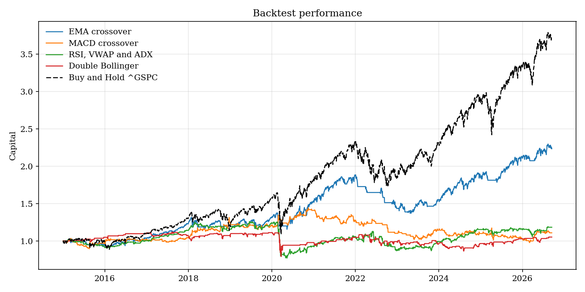

# Technical Analysis Backtest

Four technical trading rules, an EMA crossover, a MACD crossover, an RSI, VWAP and ADX confirmation rule and a double Bollinger band reversion, backtested on 20 equity indices, index futures and ETFs from January 2015 to September 2026, each against holding the same index.

## Layout

```
src/            Python modules, every parameter declared once in config.py
backtest.ipynb  the four rules, their tables, trades and the capital graph
capital.png     the capital graph, written by the notebook
```

## Strategies

**EMA crossover.** Long only. Enter when the 21-day average crosses above the 50-day one, and exit on the opposite cross or on the 5% stop.

**MACD crossover.** Long and short. Enter when the MACD histogram crosses zero, either way, and exit on the trailing stop.

**RSI, VWAP and ADX.** Long and short. Enter when the histogram is rising, the day is up and RSI, VWAP and ADX all confirm, and exit when the VWAP or the ADX condition turns.

**Double Bollinger, range bounded.** Long and short. Armed when the close leaves the outer band, entered on the close back through the inner band, and exited at the middle band.

Each rule is stated in full, entry and exit, at the top of `backtest.ipynb`.

## Performance

Capital of the four rules against holding the S&P 500, gross of transaction costs.



## Reproducing

Python 3.13 and Jupyter.

```
pip install -r requirements.txt
jupyter lab backtest.ipynb
```

The notebook downloads daily prices from Yahoo Finance and reports one table and one trade list per rule, plus the capital graph.
